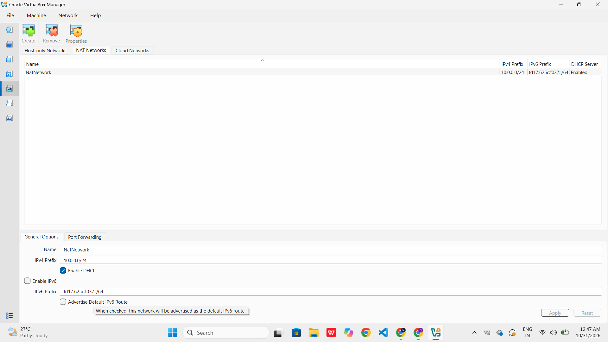
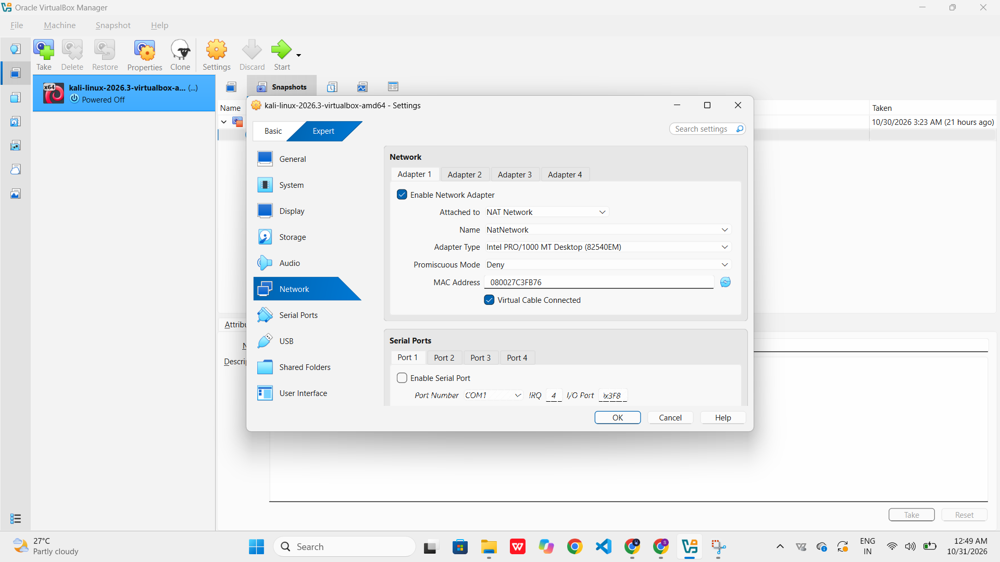
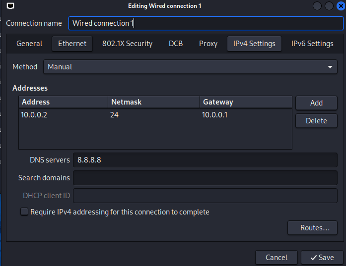
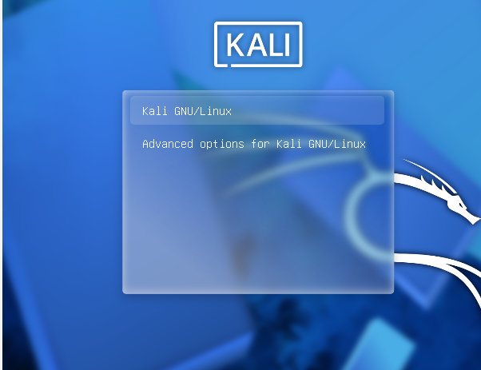
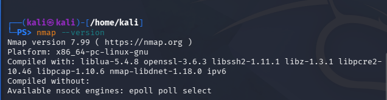
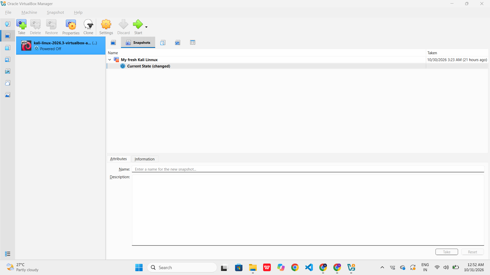

# NetworkWalks-Siddhi-B084-WK1-PM1-Cybersecurity-Lab-Setup
This is my week-1 project.
# NetworkWalks-Kshitij-B084-WK1-PM1-Cybersecurity-Lab-Setup
This is my Cybersecurity lab setup, done under project module of week-1 of internship at NetworkWalks.

# Cybersecurity Testing Lab Setup – VirtualBox + Kali Linux

> **Internship Week-1**   
> **Platform:** Oracle VirtualBox + Kali Linux  
> **Host OS:** Windows  
> **Status:** Successfully Installed and Configured  
> **Author:** Kshitij Kiran Koli  
> **Date:** October 2026

---

## 📌 Table of Contents

1. [Project Overview](#1-project-overview)
2. [Objectives](#2-objectives)
3. [Lab Architecture](#3-lab-architecture)
4. [Lab Configuration](#4-lab-configuration)
5. [Lab Setup Procedure](#5-lab-setup-procedure)
6. [Lab Verification](#6-lab-verification)
7. [Problems Encountered & Solutions](#7-problems-encountered--solutions)
8. [What I Learned](#8-what-i-learned)
9. [Tools & Resources](#9-tools--resources)
 10. [Author](#10-author)

---

## 1. Project Overview

This project documents the installation and configuration of a cybersecurity testing lab using **Oracle VirtualBox** and **Kali Linux** on a Windows host machine. Kali Linux is a Linux distribution widely used for cybersecurity, ethical hacking, penetration testing, vulnerability assessment and digital forensics.
The lab is configured using a custom **NAT Network**, allowing virtual machines to communicate with each other while accessing the internet through the host machine.

The purpose of this setup is to create a safe, isolated and reusable environment for learning Linux, practising cybersecurity tools, performing authorised penetration testing and working on future CTF challenges.

---

## 2. Objectives

| # | Requirement | Status |
|---|---|---|
| 1 | Install Oracle VirtualBox on Windows | ✅ Completed |
| 2 | Download the pre-built Kali Linux VirtualBox image | ✅ Completed |
| 3 | Extract the downloaded `.7z` archive | ✅ Completed |
| 4 | Import Kali Linux using its `.vbox` definition file | ✅ Completed |
| 5 | Attach and configure the virtual disk image (`.vdi`) | ✅ Completed |
| 6 | Successfully start the Kali Linux VM | ✅ Completed |
| 7 | Log in to the Kali Linux desktop | ✅ Completed |
| 8 | Configure a custom NAT Network | ✅ Completed |
| 9 | Configure a static IP address | ✅ Completed |
| 10 | Verify internet connectivity and DNS resolution | ✅ Completed |
| 11 | Enable shared clipboard and drag-and-drop | ✅ Completed |
| 12 | Configure a shared folder | ✅ Completed |
| 13 | Create a VirtualBox snapshot | ✅ Completed |

**Overall Status: 13/13 objectives completed.**

---

## 3. Lab Architecture

The lab uses Oracle VirtualBox on a Windows host machine. Kali Linux operates as the primary cybersecurity testing machine through a custom NAT Network.

```text
┌──────────────────────── Windows Host PC ─────────────────────────┐
│                                                                  │
│   ┌──────────────────── Oracle VirtualBox ──────────────────┐   │
│   │                                                          │   │
│   │   NAT Network: NatNetwork                                │   │
│   │   Network: 10.0.0.0/24                                   │   │
│   │   Gateway: 10.0.0.1                                      │   │
│   │   DHCP: Enabled                                          │   │
│   │          │                                               │   │
│   │          ├── Kali Linux                                  │   │
│   │          │   IP: 10.0.0.2/24                             │   │
│   │          │   DNS: 8.8.8.8                                │   │
│   │          │                                               │   │
│   │          └── Future VMs                                  │   │
│   │              Windows / Linux / CTF Machines              │   │
│   │                                                          │   │
│   └──────────────────────────┬───────────────────────────────┘   │
│                              │                                   │
└──────────────────────────────┼───────────────────────────────────┘
                               │
                               ▼
                         Internet Access
                       (Through NAT Network)
```

### Network Configuration

| Component | Configuration |
|---|---|
| Host Operating System | Windows |
| Hypervisor | Oracle VirtualBox |
| Guest Operating System | Kali Linux |
| Network Name | `NatNetwork` |
| Network Type | NAT Network |
| Subnet | `10.0.0.0/24` |
| Gateway | `10.0.0.1` |
| Kali Linux IP | `10.0.0.2/24` |
| DNS Server | `8.8.8.8` |
| DHCP | Enabled |
| Internet Access | Working |

---

## 4. Lab Configuration

### 4.1 VirtualBox NAT Network

| Setting | Value |
|---|---|
| Name | `NatNetwork` |
| IPv4 Prefix | `10.0.0.0/24` |
| Gateway | `10.0.0.1` |
| DHCP | Enabled |
| IPv6 | Disabled |



### 4.2 Kali Linux VM Settings

| Setting | Configuration |
|---|---|
| VM Name | Kali Linux |
| Base Memory | As configured in VirtualBox |
| Processors | As configured in VirtualBox |
| Virtual Disk | `.vdi` |
| Network Adapter | Adapter 1 |
| Attached To | NAT Network |
| Network Name | `NatNetwork` |
| Shared Clipboard | Bidirectional |
| Drag'n'Drop | Bidirectional |
| Shared Folder | Host Downloads folder |



### 4.3 Kali Linux Static IP Configuration

The Kali Linux network interface is configured with a static IPv4 address using NetworkManager.

| Field | Value |
|---|---|
| Method | Manual |
| Address | `10.0.0.2` |
| Netmask | `24` |
| Gateway | `10.0.0.1` |
| DNS Servers | `8.8.8.8` |



---

## 5. Lab Setup Procedure

### Step 1 – Install 7-Zip

Downloaded and installed 7-Zip to extract the Kali Linux VirtualBox archive.

Download: https://www.7-zip.org/

### Step 2 – Install Oracle VirtualBox

Installed Oracle VirtualBox on the Windows host machine.

Download: https://www.virtualbox.org/wiki/Downloads

### Step 3 – Download Kali Linux

Downloaded the pre-built Kali Linux VirtualBox image from the official Kali website.

Download: https://www.kali.org/get-kali/#kali-virtual-machines

### Step 4 – Extract the Kali Linux Archive

The downloaded `.7z` archive was extracted using 7-Zip.

The extracted files included:

- VirtualBox Machine Definition (`.vbox`)
- Virtual Disk Image (`.vdi`)

The files were stored together in a permanent folder to avoid missing virtual disk references.

### Step 5 – Import Kali Linux into VirtualBox

1. Opened Oracle VirtualBox.
2. Selected **Machine → Add**.
3. Navigated to the extracted Kali Linux folder.
4. Selected the `.vbox` machine definition file.
5. Added the Kali Linux virtual machine to VirtualBox Manager.

### Step 6 – Boot Kali Linux

Started the imported Kali Linux virtual machine through Oracle VirtualBox and verified that the operating system booted successfully.



### Step 7 – Configure the NAT Network

1. Opened VirtualBox Network settings.
2. Created a custom NAT Network named `NatNetwork`.
3. Configured the IPv4 network prefix as `10.0.0.0/24`.
4. Enabled DHCP.
5. Applied the network configuration.

### Step 8 – Configure the Kali Linux VM

1. Opened Kali VM Settings.
2. Navigated to **Network → Adapter 1**.
3. Selected **NAT Network**.
4. Selected `NatNetwork`.
5. Configured shared clipboard as Bidirectional.
6. Configured Drag'n'Drop as Bidirectional.
7. Added the host Downloads folder as a shared folder with Auto-mount enabled.

### Step 9 – Configure the Static IP Address

Opened NetworkManager connection settings and configured the IPv4 settings:

- Method: Manual
- Address: `10.0.0.2`
- Netmask: `24`
- Gateway: `10.0.0.1`
- DNS: `8.8.8.8`

### Step 10 – Verify Network Connectivity

Used Linux networking commands to verify the IP address, gateway, internet connectivity and DNS resolution.

### Step 11 – Create a VirtualBox Snapshot

Created a snapshot of the successfully configured Kali Linux virtual machine to preserve a working restore point.

---

## 6. Lab Verification

All major installation, network and VirtualBox configuration checks were successfully completed.

### 6.1 IP Address and Network Connectivity

Commands used:

```bash
ip addr
ip route
ping -c 4 10.0.0.1
ping -c 4 8.8.8.8
```

| Test | Result | Status |
|---|---|---|
| Kali IP address | `10.0.0.2/24` | ✅ |
| Default gateway | `10.0.0.1` | ✅ |
| Gateway connectivity | Successful ping | ✅ |
| Internet connectivity | Successful ping to `8.8.8.8` | ✅ |
| NAT Network | `10.0.0.0/24` | ✅ |


### 6.2 DNS Resolution and Tools Verification

Commands used:

```bash
nslookup google.com
nmap --version
```

| Test | Result | Status |
|---|---|---|
| DNS resolution | Successful | ✅ |
| DNS server | `8.8.8.8` | ✅ |
| Nmap availability | Verified | ✅ |



### 6.3 VirtualBox Configuration Verification

| Configuration | Status |
|---|---|
| Kali VM imported successfully | ✅ |
| Virtual disk attached | ✅ |
| NAT Network configured | ✅ |
| Shared Clipboard – Bidirectional | ✅ |
| Drag'n'Drop – Bidirectional | ✅ |
| Shared Folder configured | ✅ |
| VirtualBox snapshot created | ✅ |




**Final Verification:** Kali Linux is successfully installed, configured and running with the required network and VirtualBox settings.

---

## 7. Problems Encountered & Solutions

During the installation and configuration process, I encountered several issues while importing and starting the Kali Linux virtual machine.

### Problem 1 – Duplicate VM / UUID Error

**Issue:** VirtualBox reported that a virtual machine with the same UUID already existed.

**Cause:** An earlier VM registration was still present in VirtualBox.

**Solution:**

- Removed the old/broken VM registration.
- Removed the old VM files when restarting the setup.
- Started the installation process again using a fresh Kali Linux VirtualBox image.

### Problem 2 – VERR_FILE_NOT_FOUND

**Issue:** VirtualBox displayed a `VERR_FILE_NOT_FOUND` error when attempting to start the old Kali VM.

**Cause:** The virtual machine configuration referenced a `.vdi` virtual disk file that was no longer available at its original location.

**Solution:**

- Removed the broken VM.
- Downloaded the Kali VirtualBox image again.
- Extracted the archive into a permanent folder.
- Added the correct `.vbox` definition file to VirtualBox.

### Problem 3 – Missing Virtual Disk / SATA Storage Warning

**Issue:** A yellow warning indicator appeared under the SATA storage controller in the VM settings.

**Cause:** The previous virtual machine had an invalid or missing virtual disk reference.

**Solution:**

Recreated the VM registration using the freshly extracted machine definition and its corresponding virtual disk image.

### Final Outcome

After troubleshooting and performing a fresh import:

- ✅ Old broken VM removed.
- ✅ Kali Linux archive extracted successfully.
- ✅ Correct machine definition file added.
- ✅ Virtual disk attached successfully.
- ✅ Kali Linux started successfully.
- ✅ Login completed successfully.
- ✅ Network connectivity verified.
- ✅ No remaining VM startup or missing-disk errors.

---

## 8. What I Learned

- Installing and configuring Oracle VirtualBox.
- Understanding virtual machines and virtual disk images.
- Downloading and extracting pre-built Kali Linux images.
- Importing existing virtual machines using `.vbox` files.
- Understanding the role of `.vdi` virtual disks.
- Troubleshooting UUID conflicts and missing virtual disk errors.
- Understanding the difference between NAT and NAT Network.
- Configuring static IP addresses through NetworkManager.
- Verifying gateway, internet and DNS connectivity.
- Using Linux networking commands such as `ip`, `ping` and `nslookup`.
- Configuring shared clipboard, drag-and-drop and shared folders.
- Creating VirtualBox snapshots for recovery.

---

## 9. Tools & Resources

| Tool / Resource | Purpose | Link |
|---|---|---|
| Oracle VirtualBox | Virtualization platform | https://www.virtualbox.org/wiki/Downloads |
| Kali Linux | Cybersecurity operating system | https://www.kali.org/get-kali/ |
| 7-Zip | Archive extraction | https://www.7-zip.org/ |
| NetworkManager | Linux network configuration | https://networkmanager.dev/ |
| Nmap | Network discovery and security auditing | https://nmap.org/ |
| Kali Linux Documentation | Official documentation | https://www.kali.org/docs/ |

---

## 10. Author

**Siddhi Kiran Kol**

Third year Computer science Student 
Cybersecurity Intern- NetworkWalks

LinkedIn: www.linkedin.com/in/siddhi-koli-2673b5387

---

## 11. Conclusion

Successfully installed and configured Kali Linux using Oracle VirtualBox on a Windows host machine.

The lab includes a custom NAT Network, static IP configuration, internet connectivity, DNS resolution, shared clipboard, drag-and-drop functionality, shared folders and a VirtualBox snapshot.

During the installation, I encountered and resolved issues involving duplicate VM UUIDs, missing virtual disk files and SATA storage references.

This lab provides a foundation for further cybersecurity learning, ethical hacking, penetration testing and CTF exercises.

---

## Ethical Use Disclaimer

This lab is intended strictly for educational purposes and authorised cybersecurity testing.

All security testing activities must be performed only on systems and networks that I own or have explicit permission to test.
